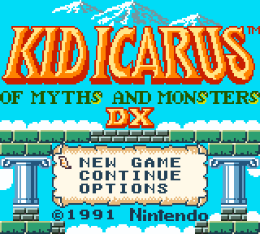
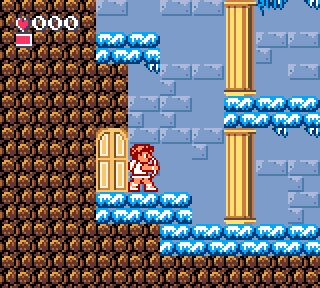
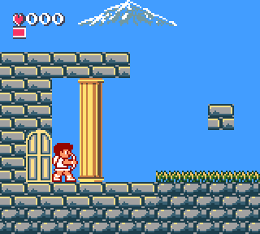
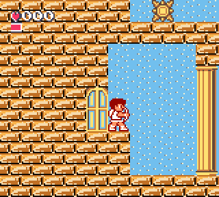
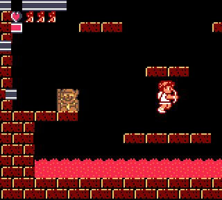
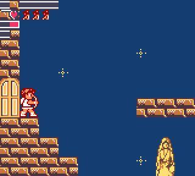
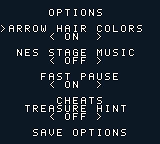
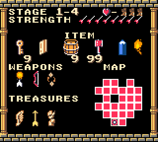
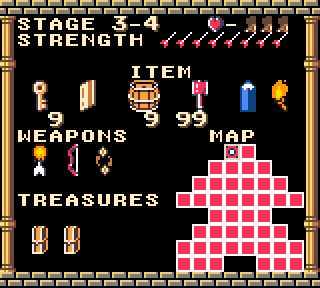

# Kid Icarus DX

**A Game Boy Color colorization of _Kid Icarus: Of Myths and Monsters_.**

Full-color stages, enemies, bosses and inventory, optional NES music, and configurable quality-of-life options—all in a patched ROM that uses the Game Boy Color's own color hardware.

**[Download the IPS patch](https://github.com/pikamus/KidIcarusDX/releases/download/v0.95/Kid-Icarus-DX-v0.95.ips)** · [Alternate download](https://raw.githubusercontent.com/pikamus/KidIcarusDX/main/patches/Kid-Icarus-DX-v0.95.ips) · **[Release notes](https://github.com/pikamus/KidIcarusDX/releases/tag/v0.95)** · **[Patching guide](PATCHING.md)**

<p align="center">
  
</p>

## About the colorization

This fan project brings color to Pit's Game Boy adventure, with palettes for the opening scroll, stages, side rooms, fortress chambers, enemies, bosses, inventory and ending scenes. The work includes artwork edits, background replacements and a consistency pass for shared sprites and animation frames.

The patch also updates scrolling transfers and sprite-palette handling for Game Boy Color, and adds an Options menu to the title screen.

**Current release: v0.95 — October 22, 2026.** This is a public preview, with full playthrough and physical-hardware validation still in progress.

## New in 0.91

- Updated colorization from the latest saved project, including pause/inventory items, weapons, treasures and unopened packages.
- New inventory and treasure-package screenshots below.
- The IPS download, patching guide and checksums now identify version 0.95. [Version 0.9](https://github.com/pikamus/KidIcarusDX/releases/tag/v0.9) remains available.

The Studio previews used to prepare this release were also corrected: inventory icons use the proper graphics, the fortress map matches the game, and opened treasures and unopened packages have dedicated preview views.

## Screenshots

| Underworld | Overworld | Skyworld |
| --- | --- | --- |
|  |  |  |

| Fortress | Sky Palace | Title options |
| --- | --- | --- |
|  |  |  |

| Inventory and treasures | Unopened treasure packages |
| --- | --- |
|  |  |

Screenshots are captured from this release with **Modern – Accurate** color correction. Appearance varies with the emulator, display and color profile.

## Options

| Option | Default | What it does |
| --- | --- | --- |
| Arrow hair colors | On | Changes Pit's hair color as his arrow strength increases. |
| NES stage music | Off | Uses Game Boy arrangements of selected themes from the NES _Kid Icarus_. |
| Fast Pause | On | Opens the inventory directly instead of showing the blinking PAUSE screen first. |
| Treasure hint | Off | Marks the unopened treasure containing the God of Poverty. Listed under Cheats. |

Select **Save options** and press **A** to keep these settings between sessions. Options are stored separately from game progress; saving options does not unlock Continue.

The optional NES soundtrack covers the opening/title, Worlds 1–3, all three fortresses, the bat challenge rooms and stage 4-1. Other music retains its original behavior. These are arrangements adapted to Game Boy audio hardware, rather than bit-identical NES playback.

## Applying the patch

1. Start with your own **unmodified USA/Europe ROM of _Kid Icarus: Of Myths and Monsters_** (262,144 bytes).
2. Download the `.ips` file using the link above. No ROM is included.
3. Apply it with an IPS-compatible patcher to a copy of the original ROM.
4. Save the patched game with a `.gbc` extension and run it in **Game Boy Color mode**.

The required original ROM's SHA-256 is:

```text
92c1fbf422abb8f09ca7fdbb563d1284108cc042e60e1222422986d9a59f9d97
```

See [PATCHING.md](PATCHING.md) for verification, save compatibility and troubleshooting. The patch is also stored in [patches/](patches/) for a direct repository download.

## Compatibility and status

- **Game Boy Color required.** The patch does not run on the original monochrome Game Boy.
- Expanded **512 KiB ROM**, using **MBC1 with 8 KiB battery-backed RAM**.
- Physical hardware and flash-cartridge compatibility have not yet been validated.
- Original monochrome palette fades currently use fixed color palettes. Some dynamic background drawing and ending effects still need playthrough review.

This build passed **77 Python tests and 17 JavaScript checks**, plus ROM header/checksum verification and an IPS round-trip check. Those checks do not replace a complete playthrough. Exact patch and ROM fingerprints are recorded in [release-manifest.json](release-manifest.json).

## Feedback

Please [open an issue](https://github.com/pikamus/KidIcarusDX/issues/new?template=bug_report.md) for incorrect colors, animation problems, scrolling glitches or audio issues. Include the patch version, emulator/device, stage and room/chamber, and steps to reproduce. Screenshots or a short video help; please do not attach ROM files.

Colorization and project direction by **[pikamus](https://github.com/pikamus)**. See [credits](CREDITS.md). This is an unofficial fan project, not affiliated with Nintendo.
